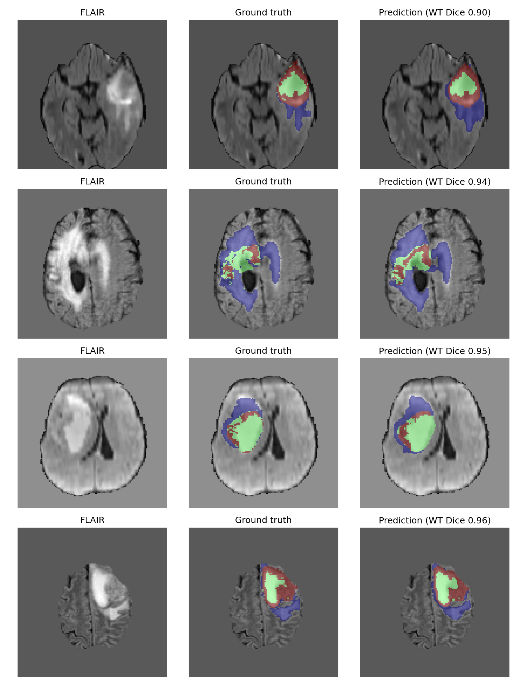
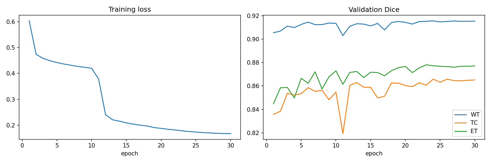
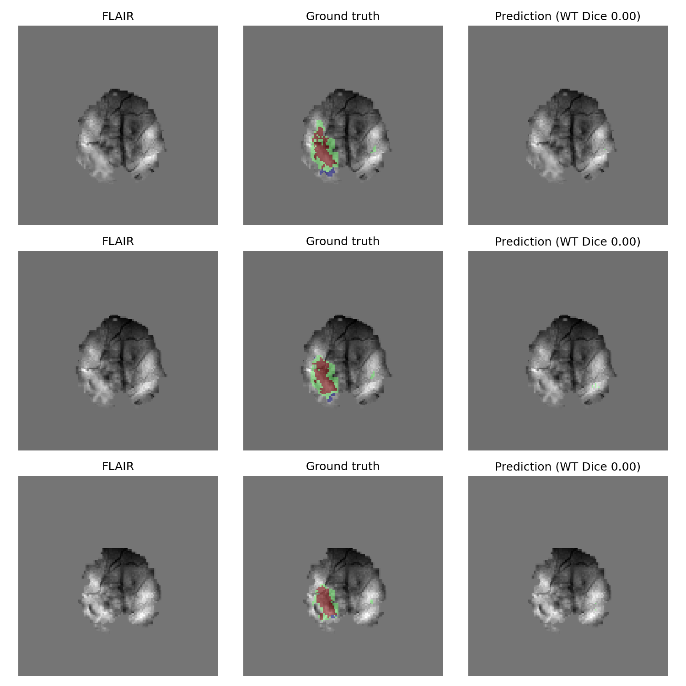

# Brain Tumor Segmentation with U-Net

Pixel-wise segmentation of glioma sub-regions (edema, non-enhancing tumor, enhancing tumor) in multi-modal brain MRI,
using a 2D U-Net trained on 484 patients from the BraTS-based Medical Segmentation Decathlon dataset.

**Test set (74 unseen patients):** Dice **0.903** whole tumor · **0.860** tumor core · **0.851** enhancing tumor



*Left: FLAIR MRI · Middle: expert annotation · Right: model prediction. Blue = edema, green = non-enhancing tumor, red =
enhancing tumor.*

## Dataset

[Medical Segmentation Decathlon — Task01 BrainTumour](http://medicaldecathlon.com/), a subset of the BraTS 2016/2017
challenge data: 484 patients with glioma, each with 4 co-registered MRI modalities and an expert annotation.

| Modality                 | What it highlights       |
|--------------------------|--------------------------|
| FLAIR                    | edema around the tumor   |
| T1                       | anatomy                  |
| T1Gd (contrast-enhanced) | active / enhancing tumor |
| T2                       | fluid and edema          |

Labels: 0 background · 1 edema · 2 non-enhancing tumor · 3 enhancing tumor

## Method

**Preprocessing** (`src/prepare_data.py`)

- z-score normalization of each modality over brain voxels (MRI intensities have no absolute scale)
- 3D volumes (240×240×155) converted to 2D axial slices: all tumor slices + 10 random tumor-free slices per patient
- center crop to 192×192, resize to 128×128
- **patient-level split** 70 / 15 / 15 (338 / 72 / 74 patients) — slices of one patient never appear in two splits,
  avoiding data leakage

**Model** — 2D U-Net ([MONAI](https://monai.io/)), 6.5 M parameters, 4 input channels (modalities), 4 output channels (
classes)

**Training**

- Loss: Dice + Cross-Entropy, to handle the strong class imbalance (tumor is a few % of each slice)
- AdamW, learning rate 1e-3 with cosine decay, batch size 16, 30 epochs
- Augmentation: random left-right flip, small random intensity shift/scale
- Best checkpoint selected by mean validation Dice
- Trained on a MacBook Air (Apple Silicon GPU via PyTorch MPS), ~4.5 min per epoch

## Results

| Split                         | WT (whole tumor) | TC (tumor core) | ET (enhancing tumor) | Mean      |
|-------------------------------|------------------|-----------------|----------------------|-----------|
| Validation (best epoch)       | 0.916            | 0.866           | 0.877                | 0.886     |
| **Test** (74 unseen patients) | **0.903**        | **0.860**       | **0.851**            | **0.871** |

Regions follow the BraTS convention: WT = classes 1+2+3, TC = 2+3, ET = 3.
The test score is only 0.015 below validation, so the model generalizes well to unseen patients.

> **Note:** Dice is computed on 2D slices (all tumor slices + 10 tumor-free slices per patient), pooled over all slices.
> It is **not directly comparable** to the official BraTS benchmark, which reports per-patient 3D Dice over the full
> volume.

### Learning curves



- Mean validation Dice reached 0.862 after the first epoch; later epochs added only ~0.02.
- No overfitting: training loss kept decreasing while validation Dice stayed stable.
- The sharp loss drop at epoch 11 did not improve validation Dice. It comes from the Dice loss on slices where a class
  is absent: that term stays near 1 until the model becomes extremely confident, then suddenly drops to ~0. This is why
  the checkpoint is selected by validation Dice rather than training loss.

## Failure analysis

The 3 test slices with the lowest whole-tumor Dice (among slices with ≥ 200 tumor pixels):



All three are **consecutive slices of one patient (BRATS_101)** near the top of the brain, where the model predicts no
tumor at all (Dice 0.00). Inspecting all four modalities shows that:

- the annotated tumor is **not clearly distinguishable in any modality** — no FLAIR hyperintensity, no visible enhancing
  ring in T1Gd;
- the annotation has almost **no edema**, unlike the typical pattern the model learned (tumor core surrounded by edema);
- the scan shows **strong intensity inhomogeneity** (bias field).

The failure is local: this patient's overall whole-tumor Dice is 0.73, so the model still segments most of the tumor in
other slices.

## Limitations and future work

**Limitations**

- **2D model:** each slice is segmented independently, without information from neighbouring slices.
- **Evaluation:** slice-level pooled Dice on selected slices, not per-patient 3D Dice as in BraTS.
- **Resolution:** images were downsampled from 192×192 to 128×128 to fit training on a laptop, which loses fine boundary
  detail.

**Future work**

- Per-patient 3D evaluation on full volumes, for comparison with the BraTS benchmark
- 2.5D input (neighbouring slices as extra channels) or a 3D U-Net
- N4 bias-field correction and stronger intensity augmentation, targeting failure cases like BRATS_101
- Compare against a baseline trained on fewer patients (200 vs 484) to measure the effect of dataset size

## How to run

```bash
# 1. environment
python -m venv .venv
source .venv/bin/activate
pip install -r requirements.txt

# 2. data: download and extract Task01_BrainTumour.tar (~7 GB) into data/
#    http://medicaldecathlon.com/

# 3. preprocessing (~40 min, ~3.5 GB)
python src/prepare_data.py --max-cases 484 --out-dir data/slices_full

# 4. open the notebook and run all cells (~2.5 h of training on a MacBook Air)
jupyter notebook brain_tumor_segmentation.ipynb
```

The dataset and trained weights are not included in the repository because of their size.

## Project structure

```
.
├── README.md
├── brain_tumor_segmentation.ipynb   # exploration, training, evaluation, failure analysis
├── requirements.txt
├── .gitignore
├── src/
│   ├── prepare_data.py              # 3D NIfTI volumes -> normalized 2D slices + patient split
│   └── dataset.py                   # PyTorch Dataset with augmentation
└── images/                          # figures used in this README
```

## Author

**Ali EbrahimiNiya** — Computer Engineering, Urmia University